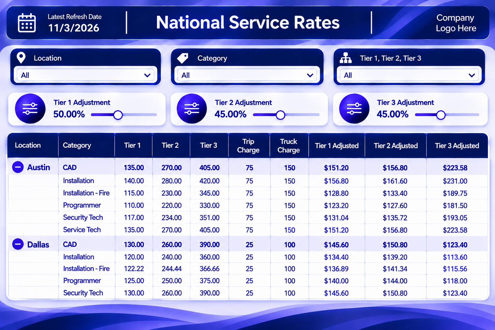

## Technical Skills

---

# 📊 Featured Project

## Service Rate Scenario Modeling

## Project Overview

Developed an interactive Power BI solution that enables stakeholders to evaluate service rate adjustments and instantly assess pricing impacts through dynamic scenario modeling and real-time calculations.

### Key Features

- Dynamic Rate Modeling
- Tier 1, Tier 2, and Tier 3 Rate Adjustments
- Interactive Scenario Planning
- Location-Based Reporting
- Service Category Filtering
- Real-Time Calculation Updates
- Executive Reporting Dashboards

### Technologies

- Power BI
- DAX
- Power Query
- Snowflake
- Third-Party Systems

### Business Impact

- Reduced manual pricing calculations
- Improved visibility into rate adjustments
- Enabled faster scenario analysis
- Increased confidence in pricing evaluations
- Supported data-driven decision making

[View Project →](service-rate-planning-tool/README.md)

---

# Additional Project Case Studies

## 💰 AR Aging & Collections Dashboard

Power BI dashboard designed to analyze accounts receivable aging, payment trends, and collection performance metrics.

---

## 🎫 Workforce Badge Tracking Process Improvement

Process improvement initiative focused on badge management, compliance tracking, and operational efficiency.

---

## ⚙️ Work Order Automation Solution

Workflow automation initiative leveraging SharePoint, Power Automate, and business process improvement methodologies.

---

