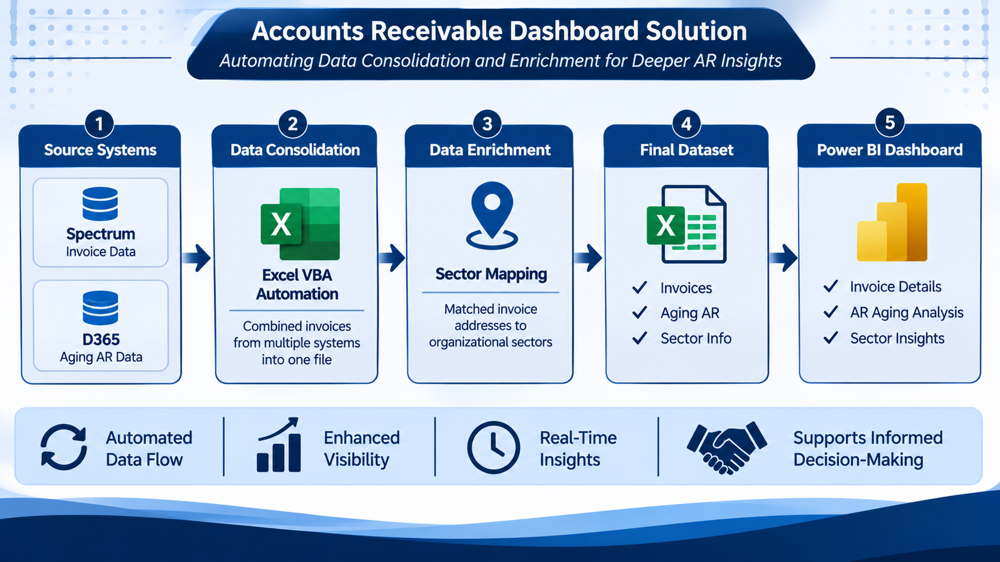

[← Back to Portfolio](../)
---

# Enterprise AR Reporting Dashboard

## Project Summary

Developed an Accounts Receivable (AR) reporting solution that improved visibility into outstanding invoices, aging balances, and collections performance for a large aerospace and defense customer.

The solution consolidated AR data from multiple ERP systems and automated reporting preparation through VBA-driven processes, delivering a centralized Power BI dashboard for financial and operational stakeholders.

---

| Business Problem | Business Impact |
|-----------------|----------------|
| Invoice and aging data existed across multiple systems, requiring teams to manually download reports from Spectrum and Microsoft Dynamics 365, merge datasets, and apply business rules to classify invoices by customer sector. The process was time-consuming, repetitive, and created opportunities for data inconsistencies and reporting delays. | • Reduced manual report preparation • Improved AR reporting accuracy • Consolidated data from multiple ERP systems • Automated customer sector classification • Increased visibility into aging balances and outstanding invoices • Improved stakeholder decision-making • Reduced administrative effort and reporting delays |

---

## Project Overview

Developed a Power BI Accounts Receivable dashboard that provided stakeholders with visibility into outstanding invoices, aging balances, and collections performance.

Invoice and AR aging reports were extracted from Spectrum and Microsoft Dynamics 365. A VBA-based Excel solution was used to consolidate datasets from both systems into a single reporting file while automatically applying business rules to associate invoice addresses with the appropriate customer sector.

The resulting dataset was leveraged within Power BI to provide centralized reporting and improve financial visibility for program stakeholders.

---

## Dashboard Capabilities

- Accounts Receivable Reporting
- Aging Balance Analysis
- Outstanding Invoice Tracking
- Customer Sector Classification
- Cross-System Data Consolidation
- Financial Performance Reporting
- AR Trend Analysis
- Collection Status Monitoring
- Interactive KPI Reporting
- Executive Reporting Views

---

## My Contributions

- Gathered and validated business reporting requirements
- Supported AR reporting and dashboard development
- Assisted with data validation and reconciliation efforts
- Tested and validated reporting outputs
- Verified customer sector mapping logic
- Collaborated with stakeholders to improve reporting accuracy
- Supported dashboard enhancements and operational reporting processes
- Assisted with documenting reporting requirements and workflows

---

## Tools Used

- Power BI
- Microsoft Excel
- VBA
- Microsoft Dynamics 365
- Spectrum ERP
- Power Query

---

## Skills Demonstrated

✅ Business Analysis

✅ Financial Reporting

✅ Data Integration

✅ Data Validation

✅ Process Improvement

✅ Stakeholder Communication

✅ Dashboard Development

✅ KPI Reporting

✅ Requirements Gathering

✅ Cross-Functional Collaboration

---

## Key Takeaway

This project demonstrates the ability to transform financial data from multiple enterprise systems into actionable business intelligence solutions. By leveraging Power BI, VBA automation, and cross-system data integration, the solution improved visibility into Accounts Receivable performance, reduced manual effort, and provided stakeholders with timely financial insights to support operational decision-making.

---

🏠 Return to Portfolio Home
