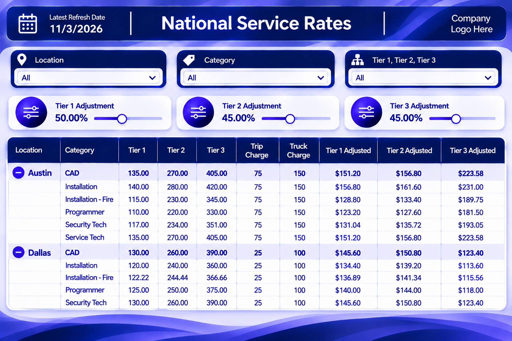

[← Back to Portfolio](../)

# Service Rate Planning Tool

  

---

## Project Summary

| Category | Details |
|-----------|-----------|
| Role | Business Analyst / BI Developer |
| Platform | Power BI |
| Data Sources | Snowflake, Third-Party Systems |
| Focus Area | Pricing Analytics |
| Technologies | DAX, Power Query |
| Deliverable | Interactive Dashboard |

---

<table>
<tr>

<td width="50%" valign="top">

## Business Problem

Stakeholders needed a way to evaluate service rate changes without manually calculating pricing impacts across multiple locations and service categories.

The existing process required manual analysis, resulting in increased effort, longer turnaround times, and a higher risk of calculation errors.

</td>

<td width="50%" valign="top">

## Business Impact

- Reduced reliance on manual pricing calculations
- Improved visibility into service rate changes
- Enabled faster scenario analysis
- Supported data-driven decision making
- Increased confidence in pricing evaluations
- Delivered a scalable reporting solution

</td>

</tr>
</table>

---

## Project Overview

Developed an interactive Power BI solution that allows users to evaluate service rate adjustments and immediately assess the impact on pricing calculations.

The solution consolidated business logic and pricing scenarios into a user-friendly dashboard that supports rapid analysis and executive decision-making.

---

## Dashboard Capabilities

- Dynamic Rate Modeling
- Tier 1, Tier 2, and Tier 3 Adjustments
- Real-Time Scenario Analysis
- Interactive Filtering
- Location-Based Reporting
- Service Category Filtering
- Executive Reporting Views
- KPI Tracking and Monitoring

---

## My Contributions

- Gathered and documented stakeholder requirements
- Designed and developed Power BI dashboards
- Created dynamic DAX calculations
- Built user-adjustable rate controls
- Implemented data validation checks
- Developed interactive filtering capabilities
- Presented solutions and findings to leadership
- Supported user acceptance testing

---

## Tools Used

- Power BI
- DAX
- Power Query
- Snowflake
- Microsoft Excel
- Third-Party Data Sources

---

## Skills Demonstrated

✅ Business Analysis

✅ Requirements Gathering

✅ Dashboard Development

✅ Data Modeling

✅ Data Visualization

✅ KPI Reporting

✅ DAX Development

✅ Stakeholder Communication

✅ Process Improvement

✅ Decision Support Analytics

---

## Key Takeaway

This project demonstrates the ability to translate business requirements into a scalable analytics solution that enables stakeholders to model pricing outcomes, evaluate service rate adjustments, and make informed decisions using real-time reporting.

---

### View Other Projects

[🏠 Return to Portfolio Home](../)

